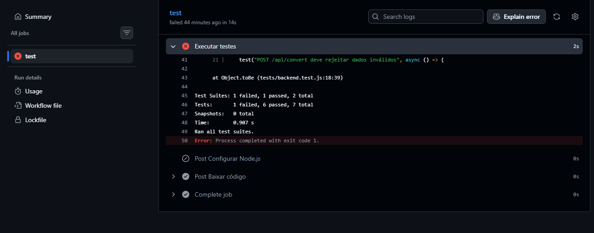

# Conversor de Moedas

Aplicação web para conversão de moedas, utilizando taxas de câmbio obtidas por uma API externa e armazenamento do histórico de conversões em banco de dados.

## Integrantes

| Nome | Matrícula |
|---|---|
| Igor Calixto Araujo | 22609116 |
| Isaac Leonardo Carneiro Sobral | 22607082 |

O projeto foi desenvolvido em colaboração pelos dois integrantes, desde a implementação das funcionalidades até os testes, integração e documentação.

## Tecnologias utilizadas

- **Frontend:** HTML, CSS e JavaScript.
- **Backend:** Node.js e Express.
- **Banco de dados:** Supabase (PostgreSQL).
- **API externa:** Frankfurter API.
- **Testes automatizados:** Jest e Supertest.
- **Integração contínua:** GitHub Actions.
- **Containerização:** Docker.
- **Publicação da imagem:** Docker Hub.

## Funcionalidades

- Conversão entre diferentes moedas.
- Consulta de taxas de câmbio por API externa.
- Listagem de moedas disponíveis.
- Armazenamento das conversões no Supabase.
- Consulta do histórico de conversões.

## Funcionamento

O frontend disponibiliza a interface para interação com o usuário. As solicitações são processadas pelo backend, desenvolvido com Node.js e Express.

O backend consulta as taxas de câmbio na API Frankfurter e utiliza o Supabase para armazenar e recuperar o histórico de conversões.

## Como executar localmente

**1. Clone o repositório:**

```bash
git clone https://github.com/igorCalixtoAraujo/bootcamp2-projeto-final.git
cd bootcamp2-projeto-final
```

**2. Instale as dependências:**

```bash
npm install
```

**3. Configure as variáveis de ambiente.**

Crie um arquivo `.env` na raiz do projeto:

```env
SUPABASE_URL=https://wlwkpkavywghxdszkkyu.supabase.co
SUPABASE_SECRET_KEY=chave_secreta_do_comentario
```
É necessário substituir "chave_secreta_do_comentario" pela chave screta que enviei no comentário da atividade, por questões de segurança

**4. Inicie a aplicação:**

```bash
npm start
```

Acesse http://localhost:3000.

## Rotas da API

| Método | Rota | Descrição |
|---|---|---|
| GET | `/` | Verifica o funcionamento da API |
| GET | `/api/currencies` | Lista as moedas disponíveis |
| GET | `/api/rate` | Consulta a taxa de câmbio |
| POST | `/api/convert` | Realiza uma conversão |
| GET | `/api/history` | Consulta o histórico de conversões |

## Testes automatizados

O projeto utiliza Jest e Supertest para verificar o funcionamento das funcionalidades.

Para executar os testes:

```bash
npm test
```

Atualmente, o projeto possui 7 testes automatizados, distribuídos em 2 suítes.

## Integração contínua (CI)

Foi configurado um workflow em `.github/workflows/ci.yml`, utilizando GitHub Actions.

Os testes são executados automaticamente durante a abertura e atualização de Pull Requests direcionadas à branch `main`, ajudando a garantir a qualidade das alterações antes da integração.

## Docker

O projeto possui um `Dockerfile` para construção da imagem da aplicação e um `.dockerignore` para excluir arquivos desnecessários e informações sensíveis.

A imagem é publicada automaticamente no Docker Hub por meio do workflow `.github/workflows/docker-publish.yml`, após alterações na branch `main`.

**Imagem publicada:**

`igorcalixto887/conversor-moedas:latest`

### Como executar a imagem Docker

```bash
docker run -d \
  --name conversor-moedas \
  -p 3000:3000 \
  -e SUPABASE_URL="https://wlwkpkavywghxdszkkyu.supabase.co" \
  -e SUPABASE_SECRET_KEY="chave_secreta_do_comentario" \
  igorcalixto887/conversor-moedas:latest
```

A aplicação ficará disponível em http://localhost:3000.
É necessário substituir "chave_secreta_do_comentario" pela chave screta que enviei no comentário da atividade, por questões de segurança

## Organização do desenvolvimento

O desenvolvimento foi realizado utilizando Git e GitHub, com branches específicas para implementação das funcionalidades e Pull Requests para integração das alterações.

A branch `main` foi protegida para exigir Pull Requests, aprovação de outro integrante e aprovação das verificações automatizadas antes da mesclagem.

## Evidência de bloqueio de Pull Request



A evidência deve demonstrar que o GitHub impediu a mesclagem devido à falha nos testes automatizados.

## Conflitos de mesclagem

Não houve conflitos de mesclagem durante o desenvolvimento do projeto.

## Repositório

[GitHub — Conversor de Moedas](https://github.com/igorCalixtoAraujo/bootcamp2-projeto-final)

## Docker Hub

[Imagem do projeto no Docker Hub](https://hub.docker.com/r/igorcalixto887/conversor-moedas)
